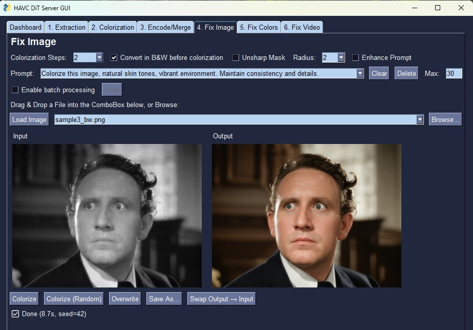
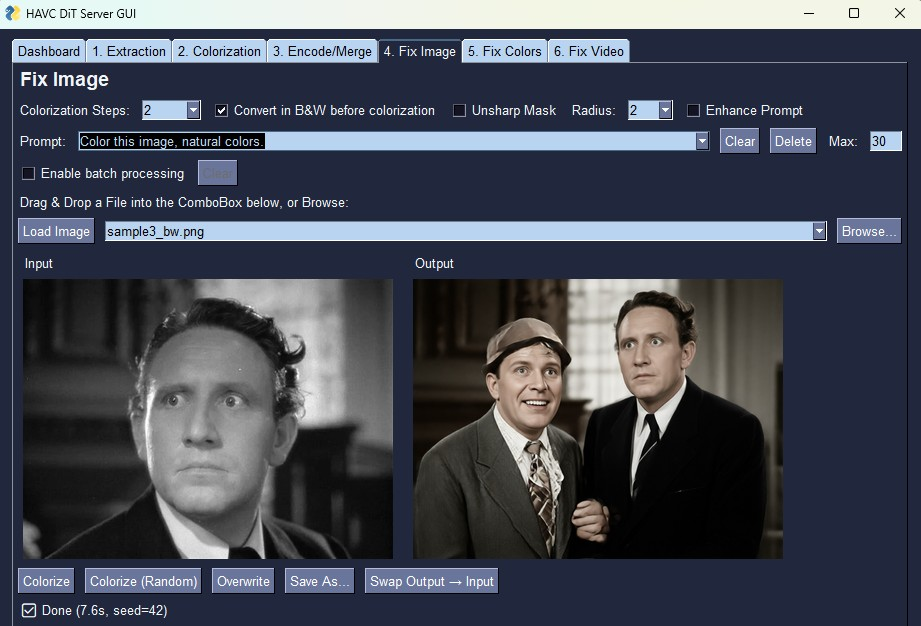

# Troubleshooting

**`CUDA out of memory`**
Close other GPU applications. On 16 GB cards the server automatically enables sequential CPU offload for layers that do not fit in VRAM.

**`dit_colorize_main.py NOT FOUND`**
Use `--module-dir` to point the server to the directory that contains `dit_colorize_main.py`:

```bash
python dit_rpc_server.py --module-dir /path/to/dit_colorize_main
```

**`Model 'xxx' is not supported`**
Supported values for `model_name` are `"nunchaku-qwen"` (FP4/INT4), `"gguf-qwen"` (Qwen-Image-Edit 2511: native int8 ConvRot or GGUF Q3_K_S), `"qwen25-nunchaku"` (Qwen-Image-Edit 2509/2511 on the ComfyUI-nunchaku node), `"longcat-gguf"`, `"qwen21-viggle"`, `"qwen21-turbo"`, `"flux2"` (FLUX.2-dev and Flux.2 Klein) and `"flux3"` (FLUX.3 Image Klein). For `"gguf-qwen"`, the checkpoint is selected by the `unet_gguf` file in the config (a `.safetensors` int8 ConvRot or a `.gguf` quant).

**Pipeline takes a long time to load**
**Nunchaku**: on the first run the model weights (~15–30 GB) are downloaded from HuggingFace.
Subsequent runs load from the local cache.
**GGUF**: only the VAE and tokenizer (~320 MB) are downloaded from HuggingFace; the UNet and CLIP are loaded directly from the local `.gguf` files. Set `cache_dir` in the config to control where the cache is stored.

**Colors look faded or grayish**
Increase the number of **Colorization Steps** and/or disable **Fast Pipeline**, then re-run — **LongCat** in particular is calibrated for 8 steps, and at 4 steps the colors are faded. See [Suggested Inference Steps](server_usage.md#-suggested-inference-steps) for the recommended per-model values.

**qwen-2511: the output duplicates the subject or leaves part of the frame gray**
Prompt sensitivity, not an installation bug: some wordings make Qwen-Image-Edit 2511 hallucinate — a second copy of the person appears and part of the frame stays uncolored. It reproduces identically in plain ComfyUI with the same workflow, seed and input file; only the prompt wording fixes it. Same frame, same settings:

`Colorize this image, natural skin tones, vibrant environment. Maintain consistency and details.`



`Color this image, natural colors.`



The sensitivity is per-wording and not monotonic: long emphatic prompts can color some subjects wrong, and some very terse ones (like the second above) can trigger the duplication. A wording that stays clean on portrait frames:

> Colorize this image, natural skin tones, vibrant environment. Maintain consistency and details.

The shipped default is *"Colorize this image, natural colors. Strictly preserve
all shapes, edges and background details."* — GUI protected preset #1 and the
`prompt` of every Qwen-Image-Edit and FLUX.2 config. With **Enable Prompt
Config** the field and the preset list are not what a run sends: the config's
`prompt` is. If it misbehaves on your frames, the two prompts above are the
ones with side-by-side evidence — try them before changing other settings.

(Grainy film sources are a separate known trigger — the model can leave them fully B&W; use the **Unsharp Mask** pre-filter, see [GUI usage](gui_usage.md).)

**FLUX.2-dev int4 on a 16 GB card: per-frame times swing a lot (e.g. 7 s to 50 s)**
The int4 checkpoint (18.3 GB) almost fits a 16 GB card, and without a reserve
aimdo's DynamicVRAM fills the VRAM to the brim, leaving nothing for the
activations — the cost of each pair of frames then varies with what has to be
re-faulted. `config/flux2_dev_int4.json` ships `"vram_headroom": 3` for
exactly this; confirm the setting reached aimdo in the server log
(`DynamicVRAM: extra VRAM headroom 3.00 GB (config vram_headroom)`). If you
edited the config to `0`, that is the cause. See
[Backends](backends.md#vram_headroom--the-int4-checkpoints-setting-per-vram-size)
for the right value per VRAM size (12 GB and 24 GB+: `0`).

**Downloading a model fails with 401 / "access is restricted"**
That repository is **gated**: the file listing is public but the download needs
the license accepted. `black-forest-labs/FLUX.2-klein-9b-fp8` and
`black-forest-labs/flux-3-image-klein-comfy` (all of `flux3`) are like that.
Open `https://huggingface.co/<repo>` in a browser, accept the license with the
account whose token this machine uses (`HF_TOKEN`, or `huggingface-cli login`),
then retry — no reinstall needed. The engine names the repository in the error
instead of failing later with a missing file. The shipped Flux.2 Klein configs
(the INT8 ConvRot files), their text encoders and the Flux.2-dev checkpoints
are **not** gated.

---

## Installation and updates

**SmartScreen warning on `HAVC-Setup-*.exe`**
The installer is not code-signed yet: *Windows protected your PC* → **More info** → **Run anyway**. The sha256 of every asset is published in the release notes if you want to verify the download first.

**"The manifest could not be fetched" in the installer**
Check the connection first. As fallbacks: keep a `release.json` next to the exe (it ships in the release assets), or launch the manager with `--release-tag vX`.

**An update brought no new files, and Repair did not either**
*Repair* restores the currently installed version from the cached wheel — it never upgrades. New or changed files arrive with an *update* ("Check for updates").

**The uninstaller asks about the user files**
The default keeps the model files (`<install>\comfy_bridge\models`, tens of GB), the saved GUI settings (`<install>\gui\gui_cmnet2_settings.json`) and the pipeline configs (`<install>\config\`, including configs you added or edited): reinstalling into the same folder reuses them without re-downloading, and the manager asks before replacing any config that differs from the packaged one. Tick the option in the dialog to delete them too.
